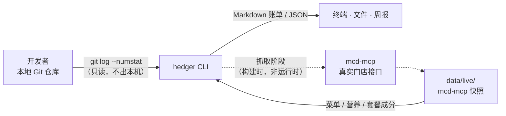
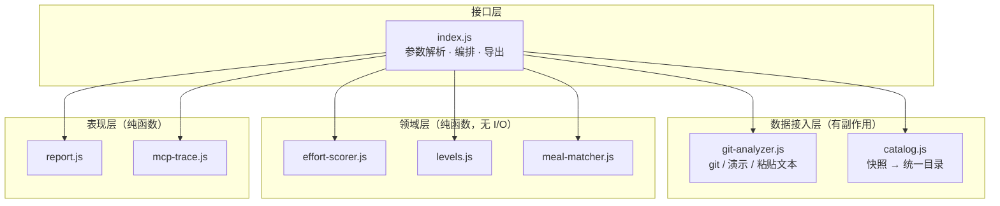
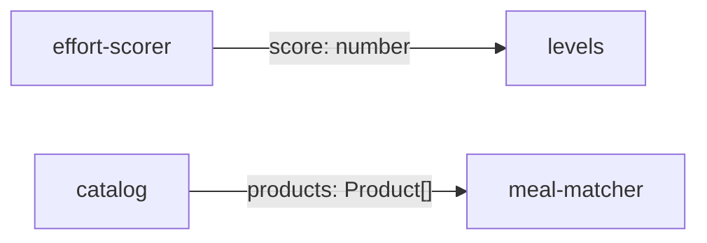
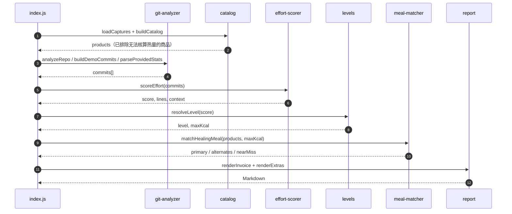

# 架构说明

> 本文描述系统边界、模块职责、数据契约与关键设计决策。算法细节见 [ALGORITHM.md](./ALGORITHM.md)。

## 1. 系统上下文

系统是一个**单机 CLI**，不依赖任何服务端组件。它只做三件事：读本地 Git、读本地快照、在终端打印账单。



两条边界值得强调：

- **运行时零网络请求。** 结算完全基于仓库内置快照，因此在没有 MCP 凭据、没有网络的环境里也能复现同一份结论。
- **代码内容不出本机。** 只把聚合后的「增删行数、提交次数」用于计算，文件名仅用于展示。

## 2. 分层与依赖方向



依赖只向下、不反向：领域层不 `import` 任何 I/O 模块，因此可以在测试里用普通对象直接驱动，不需要 mock 文件系统或 Git。三个领域模块之间也互不引用——拼接顺序由 `index.js` 决定。



上图表示的是**数据依赖**而非模块导入：箭头两端的模块并不知道彼此存在，中间的类型契约由调用方保证。

## 3. 模块清单

| 模块 | 职责 | 输入 | 输出 | 副作用 |
| --- | --- | --- | --- | --- |
| `index.js` | 参数解析、场景编排、产物导出 | `process.argv` | stdout / 文件 | 读文件、写文件 |
| `src/git-analyzer.js` | 三种数据源统一成 `GitCommit[]` | cwd、时间窗、文本 | 提交列表 | 子进程 `git` |
| `src/effort-scorer.js` | 工作量评分 + 上下文信号 | `GitCommit[]` | `Effort` | 无 |
| `src/levels.js` | 分数 → 等级 → 热量上限 | `score` | `Level` | 无 |
| `src/catalog.js` | 三份快照拼成可核算目录 | 快照对象 | `Catalog` | 读文件 |
| `src/meal-matcher.js` | 硬约束过滤 + 加权排序 | 商品、预算 | `MealMatch` | 无 |
| `src/report.js` | 账单主体、补充说明、对照表 | 结算结果 | Markdown | 无 |
| `src/mcp-trace.js` | 渲染 MCP 调用记录 | `session.json` | Markdown | 无 |

`src/` 共约 1100 行，行覆盖率 92.3%（`npm run test:coverage`）。

## 4. 主流程



## 5. 数据契约

三个对象构成模块之间的全部接口。它们都是普通 JSON 可序列化结构，`--json` 直接输出同构内容。

### 5.1 `Effort`（评分输出）

```json
{
  "score": 1570,
  "lines": { "added": 700, "deleted": 320, "total": 1020 },
  "commitCount": 13,
  "breakdown": [
    { "key": "added", "label": "新增 700 行 × 1", "points": 700 },
    { "key": "deleted", "label": "删除 320 行 × 1.5", "points": 480 },
    { "key": "commits", "label": "提交 13 次 × 30", "points": 390 }
  ],
  "context": { "fileCount": 10, "nightCommits": 2, "weekendCommits": 13, "hotfixCommits": 3, "spanHours": 14 }
}
```

`context` 字段**不参与得分**，只用于账单补充说明——这是刻意的：把主观信号从客观分里剥离，避免热修日被双重惩罚。

### 5.2 `Product`（目录条目）

```json
{
  "code": "5129a077",
  "name": "麦辣鸡腿汉堡三件套",
  "kind": "combo",
  "price": 33.5,
  "originalPrice": 46.0,
  "saved": 12.5,
  "discountRate": 0.2717,
  "kcal": 921,
  "components": [{ "name": "麦辣鸡腿堡", "qty": 1, "kcal": 485 }],
  "kcalSource": "query-meal-detail(5129a077) + list-nutrition-foods"
}
```

`kcal` 为 `null` 的条目不会进入匹配——它们会被记入 `catalog.unresolved`，并在账单里明确写出「已排除 N 个无法核算热量的商品」。

### 5.3 `MealMatch`（匹配输出）

```json
{
  "calorieMax": 2000,
  "primary": { "name": "麦辣鸡腿汉堡三件套 ×2", "kcal": 1842, "score": 68.88 },
  "alternates": [],
  "nearMiss": { "name": "全明星双人分享餐八件套", "kcal": 2142, "over": 142 },
  "stats": { "fitting": 34, "combos": 6, "singles": 22, "doubles": 6 }
}
```

## 6. 系统不变式

这些性质由测试直接断言，改动代码时不应破坏：

| 编号 | 不变式 | 保障位置 |
| --- | --- | --- |
| I1 | 推荐结果的总热量 **永不超过** 当日上限 | `meal-matcher` 过滤 + 测试「任何额度下推荐都不超支」 |
| I2 | 空提交列表得 0 分并落入 L1，而不是崩溃 | `scoreEffort` + 测试 |
| I3 | 名称对不上营养表时返回 `null`，**绝不估算** | `resolveKcal` + 测试 |
| I4 | 同款多份放大后折扣率不变 | `multiplyPortion` + 测试 |
| I5 | 快照门店与请求门店不一致时**报错而非静默回退** | `buildCatalog` |
| I6 | 账单字段与顺序固定，可被外部程序解析 | `renderInvoice` + 测试 |

## 7. 关键设计决策

| 编号 | 决策 | 备选方案 | 取舍理由 |
| --- | --- | --- | --- |
| ADR-001 | 用 Git 增删行数衡量工作量 | 工时填报、IDE 活跃时长 | Git 是开发过程的副产品，不可伪造、有粒度、零侵入；工时是自报的 |
| ADR-002 | 删除权重 1.5 > 新增 1.0 | 等权 | 重构与删除祖传代码的认知负荷高于新增；等权会奖励堆砌 |
| ADR-003 | 提交权重 30（非规范建议的 50） | 50 | 50 时「2 次提交」即 100 分，L1（0~1 次提交）几乎不可达；30 使四档都可达。量化标定见 ALGORITHM.md §3 |
| ADR-004 | 深夜 / 周末 / 热修不计分 | 各加 12 / 10 / 25 分 | 避免与行数双重惩罚；且「深夜」依赖时区与作息，不具备跨用户可比性 |
| ADR-005 | 额度取固定档位值，不做档内插值 | 线性插值 | 账单需要可解释：一句「你落在 L3，上限 1100」胜过一条分段函数 |
| ADR-006 | 结算读快照而非实时请求 | 每次实时调用 MCP | 可复现性优先。快照带 `capturedAt` 与 `traceId`，可逐条对账 |
| ADR-007 | 热量按成分逐项累加，缺失即排除 | 按品类均值估算 | 估算一个「看起来合理」的数字会让整份账单的可信度归零 |
| ADR-008 | 允许同款套餐点两份 | 只允许单份 | 门店最高套餐 949 kcal，L4 的 2000 额度单份永远用不满，会退化成「努力一天推荐你吃个套餐」 |

## 8. 失败模式与处理

| 场景 | 行为 | 退出码 |
| --- | --- | --- |
| 当前目录不是 Git 仓库 | 提示改用 `--demo` / `--input`，不进入结算 | 2 |
| `git log` 执行失败 | 返回 `ok:false` 与原因，不抛栈 | 1 |
| 未知演示场景 | 列出可选值 | 2 |
| 快照门店与 `--store` 不一致 | 明确报错并提示重新抓取，不静默回退 | 1 |
| 商品名不在营养表 | 排除该商品，账单注明排除数量 | 0 |
| 额度内无合规商品 | 输出「暂无合规套餐」，仍打印等级与额度 | 0 |
| 输入文本无法识别统计 | 提示需要 `insertions(+)` / `deletions(-)` / `files changed` | 1 |

原则：**能降级就降级，不能降级就明说，绝不猜。**

## 9. 扩展点

- **换数据源**：实现一个返回 `GitCommit[]` 的函数即可，下游完全无感（现有三个数据源就是同一契约的三次实现）。
- **换评分函数**：只改 `src/effort-scorer.js` 的 `WEIGHTS` 与公式，测试会立刻告诉你哪些档位漂了。
- **换匹配策略**：`matchHealingMeal(products, budget, options)` 是纯函数，可以在不改 CLI 的前提下替换为组合优化版本。
- **接真实下单**：`calculate-price` / `create-order` 属于副作用，应放在接口层新增的适配器里，不进入领域层。

## 10. 代码地图

```
index.js                 参数解析 → 编排 → 输出
src/git-analyzer.js      三种数据源 → GitCommit[]
src/effort-scorer.js     GitCommit[] → Effort
src/levels.js            score → Level → budget
src/catalog.js           快照 → Product[]（含排除项）
src/meal-matcher.js      Product[] + budget → MealMatch
src/report.js            MealMatch → Markdown
src/mcp-trace.js         session.json → Markdown
test/hedger.test.js      24 个用例，覆盖 5 层
data/live/*.json         带 traceId 的真实快照
```
